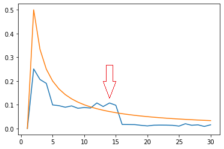
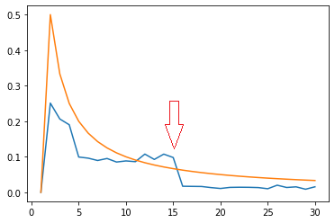
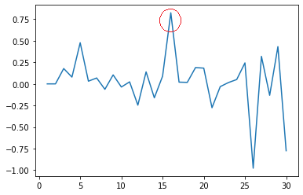
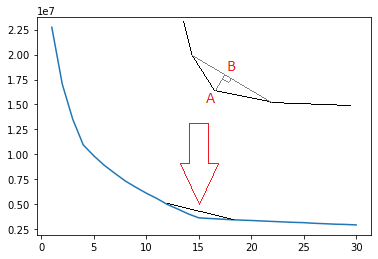
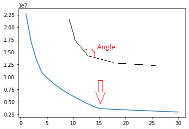

# kmeans_kfinder

KMeans k finder: finds the best k (number of clusters) on a supplied dataset.
Works on top of the scikit-learn KMeans implementation.
Uses five different methods to find best k; the final result is the majority vote
among all methods (larger k wins ties).

## Install

```bash
pip install scikit-learn numpy       # runtime dependencies only
pip install -e ".[dev]"              # plus pytest and ruff for development
```

## Usage

```python
from sklearn.datasets import make_blobs
from kmeans_kfinder import KMeansKFinder

X, y = make_blobs(n_samples=400, centers=4, cluster_std=1.0, random_state=42)  # ground truth k = 4

kmf = KMeansKFinder(X, max_k=30, random_state=13)   # random_state for reproducibility
best_k = kmf.find_best_k()

print(best_k)           # 4, the ground truth
print(kmf.best_k_opts)  # all five methods agree here
print(kmf.summary())    # the table the methods work on
model = kmf.fit_best()  # KMeans fitted with best_k (cached)
```

On well separated data the methods agree; on ambiguous data they do not, and the vote can be a thin
majority. Iris is the honest example of that:

```python
from sklearn.datasets import load_iris

kmf = KMeansKFinder(load_iris().data, max_k=30, random_state=13)
print(kmf.find_best_k())    # 7, while the true number of labels is 3
print(kmf.best_k_opts)      # 2, 7, 7, 2, 7 -> three methods out of five
```

Pass any KMeans parameters as keyword arguments; `n_clusters` is managed by the
finder and a value given here is ignored.

## Methods

### method #1
k at max difference between `delta_kmeans_distance_pct` and `diff_delta_distance_complexity`,
where `delta_kmeans_distance_pct` represents KMeans distance decrease (derivative of the
distance) and `diff_delta_distance_complexity` is that decrease minus `1/k`.

`1/k` is a fixed complexity **cost penalty**, not the derivative of complexity — the method is a
trade-off between the relative gain of adding a cluster and the cost of having k clusters.
Using the actual derivative `1/k - 1/(k-1) = -1/(k(k-1))` makes the penalty decay as `1/k²`, so
the score degenerates into "largest single drop" and returns k = 2 in 179/190 measured runs;
agreement with the known ground truth k falls from 85/120 to 35/120 runs on well separated data
and the final vote does not improve (`reports/method1_grid.txt`, `reports/method1_variants.txt`).
The documented formula is therefore kept.



### method #2
k, which is previous to the last significant drop of `delta_kmeans_distance_pct`,
where `delta_kmeans_distance_pct` represents KMeans distance decrease (derivative of the
distance) and only drops that are at least 25% of the largest drop are taken into account.



### method #3
k at max `delta_of_delta_kmeans_distance_pct`,
where `delta_of_delta_kmeans_distance_pct` is the derivative of `delta_kmeans_distance_pct`,
which means it is a second order derivative of the KMeans distance.



### method #4
k at max triangle height,
where the triangle consists of three nearest points of the KMeans distance plot.



### method #5
k at minimal angle on the KMeans distance plot. True elbow method.



## Which k each method reports

The methods report k in two different ways, on purpose:

| method | reports | because the method selects |
|---|---|---|
| 1 | the row itself, `k` | the row where gain − cost penalty is largest |
| 2 | elbow vertex `k - 1` | the point before the last significant drop |
| 3 | elbow vertex `k - 1` | vertex of the second derivative |
| 4 | elbow vertex `k - 1` | vertex of the triangle of three neighbouring points |
| 5 | elbow vertex `k - 1` | vertex of the angle (true elbow) |

Measured over 120 runs on datasets with separated clusters, each method agrees with the known k
better with its own convention than with the opposite one:

| method | own convention | opposite convention |
|---|---|---|
| 1 | 85/120 | 0/120 |
| 2 | 102/120 | 11/120 |
| 3 | 70/120 | 8/120 |
| 4 | 79/120 | 14/120 |
| 5 | 98/120 | 16/120 |

Making all five conventions uniform would drop vote accuracy from 97/120 to 14/120
(`reports/convention.txt`), so the mixed convention is kept.

## Notes and limitations

* `max_k` is limited to the number of samples, because KMeans cannot create more
  clusters than samples.
* Values that are not defined for a given k (first rows of the table, or division by
  zero on zero-variance data) are reported as `None` and never win a method. If no
  method produces a result, `best_k` is `None` instead of an arbitrary k.
* The five methods disagree on overlapping clusters — that is normal for elbow
  heuristics, and the majority vote is only a consensus, not a proof. On well separated
  data all five methods agree; on ambiguous data a majority of two out of five can be
  fragile, so `random_state` should be set and results should be checked against a
  quality metric such as silhouette score.
* Methods 4 and 5 scale the plot x axis by `max_k`, so their answer can change when `max_k`
  changes: on the measured datasets the final answer changes on 2/24 separated datasets
  (`reports/max_k_sensitivity.txt`). Report the `max_k` you used.
* On 120 runs over datasets with separated clusters the final vote matches the known k in
  97/120 runs (`reports/convention.txt`). Elbow heuristics are not a quality metric; use
  silhouette score or a labelled check when the answer matters.

## Sample dataset and tests

`sample_dataset.py` generates reproducible datasets with a known ground truth k
(the CSV files it writes to `data/` are generated output and are not committed):

```bash
python3 sample_dataset.py     # writes data/<dataset>.csv
python3 demo.py               # prints the stats table and the method results
python3 -m pytest tests/ -q
```

The tests are written against the documented behaviour and can be run against any
implementation, which is how the improvements were measured:

```bash
python3 -m pytest tests/ -q                                          # current code
KFINDER_MODULE=baseline.kmeans_kfinder_baseline python3 -m pytest tests/ -q   # pre-change code
python3 measure.py baseline.kmeans_kfinder_baseline kmeans_kfinder   # before/after comparison
```

`reports/COMPARISON.md` contains the measured before/after results. `experiments/`
contains the scripts behind the numbers quoted in the documentation; each one writes its
output to `reports/<name>.txt`:

```bash
python3 experiments/method1_grid.py          # method 1 formulations, penalty strength grid
python3 experiments/method1_variants.py      # effect of each variant on the final vote
python3 experiments/convention.py            # k vs k - 1 reporting convention per method
python3 experiments/max_k_sensitivity.py     # answer stability across max_k
```

## Repository layout

```
kmeans_kfinder.py      the library
py.typed             PEP 561 type-hint marker
sample_dataset.py      reproducible datasets with known ground truth k
demo.py                prints the stats table and the method results
measure.py             before/after harness used for the measurements
tests/                 behaviour tests + expected baseline results
baseline/              untouched copy of the pre-change code (measurement reference)
experiments/           analysis scripts, not production code
reports/               saved measurements quoted by the README
opt1.png ... opt5.png  method illustrations
```

Lint: `ruff check .` (line length 100). Tests: `python3 -m pytest tests/ -q`.
